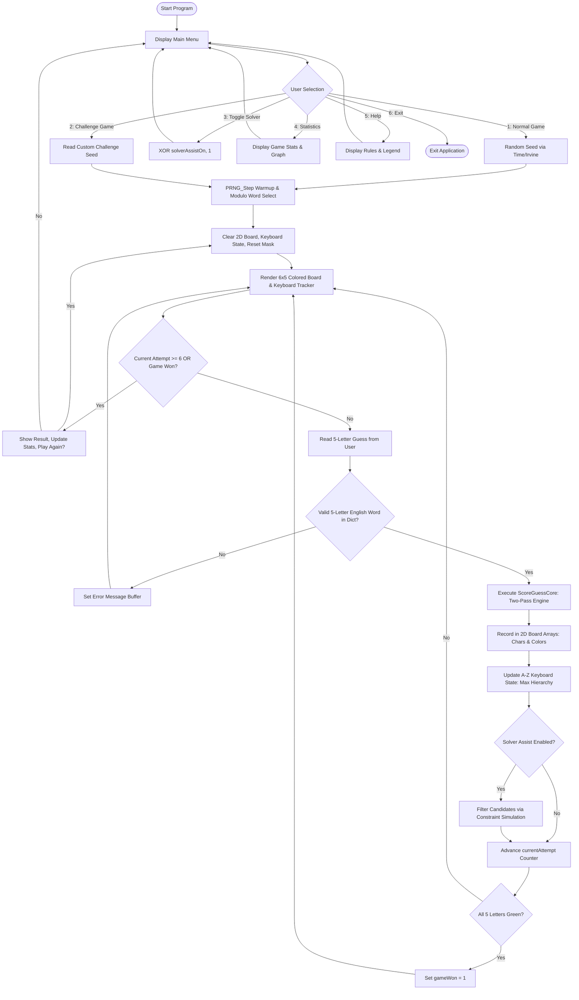

# Assembly Wordle with Solver Assist
## Comprehensive Course Project Report

**Course:** Computer Organization & Assembly Language (COAL) Lab  
**Institution:** National University of Computer & Emerging Sciences (FAST-NUCES), Karachi Campus  
**Class/Section:** BAI – 3C  
**Academic Year / Semester:** Fall 2026 / Semester 03  

### Project Group
| Name | Roll Number | Role / Contributions |
| :--- | :--- | :--- |
| **Adeel Sabar** | 25K-0101 | Lead Architect: 2-Pass Scoring Engine, Input Validation, Project Assembly Integration |
| **Syed Yahya Raza** | 25K-0019 | Systems Engineer: 32-bit Shift PRNG, Challenge Code System, Automated Test Suite |
| **Muhammad Asmaar** | 25K-0057 | UI & Analytics Engineer: 2D Board Rendering, A-Z Keyboard Tracker, Solver Assist Engine |

---

## 1. Introduction & Problem Statement

Wordle is a deduction game where the player seeks to discover a secret 5-letter word within six attempts, receiving positional color feedback (Green, Yellow, Gray) on each guess. While high-level implementations of Wordle in languages like Python or JavaScript rely heavily on native strings, associative maps, and garbage-collected heaps, constructing this game at the machine level in **x86 32-bit assembly language (MASM)** demands deliberate, low-level architectural design.

Every single operation—down to index arithmetic, character case conversion, stack frame management, conditional branching, console video buffer attributes, and duplicate letter arbitration—must be engineered explicitly using microprocessor instructions and CPU registers.

### Special Contributions
Our project introduces two novel features that distinguish it from conventional console games:
1. **Solver Assist Engine**: A machine-level constraint satisfaction filter that simulates the player's received feedback against all dictionary words, computing the exact candidate count and remaining possibilities in real-time.
2. **Challenge Code System**: An original 32-bit linear shift-and-XOR pseudo-random number generator (PRNG). Instead of relying purely on system time, two players can input the same numeric seed (e.g. `#424242`) to compete on the exact same hidden word.

---

## 2. Project Architecture & Flowchart

The application is structured into decoupled, single-responsibility procedures operating on shared data segments.



---

## 3. Data Layouts & Memory Representation

All core state data resides in the `.data` segment without requiring dynamic heap allocation.

### 3.1 Fixed-Width Dictionary (`wordList`)
- Stored as fixed-width entries of 6 bytes: 5 ASCII uppercase characters + 1 null terminator byte (`0`).
- Total words: 150 standard 5-letter English words.
- Base address calculation:
  $$\text{Effective Address} = \text{OFFSET wordList} + (i \times 6)$$

### 3.2 2D Board Representation
The board tracks both characters and their associated color attributes across 6 attempts and 5 columns:
- `boardChars BYTE 30 DUP(' ')`: 6 rows $\times$ 5 columns character array.
- `boardColors BYTE 30 DUP(0)`: 6 rows $\times$ 5 columns color status array.
- Row-major memory offset for attempt $r \in [0, 5]$ and letter position $c \in [0, 4]$:
  $$\text{Index}(r, c) = (r \times 5) + c$$
  Implemented in MASM:
  ```assembly
  mov eax, currentAttempt
  imul eax, WORD_LEN       ; eax = r * 5
  add eax, ecx             ; eax = (r * 5) + c
  ```

### 3.3 Dynamic A-Z Keyboard Tracker
- `keyboardState BYTE 26 DUP(0)`: Indexes 0 through 25 map directly to ASCII characters `'A'` through `'Z'` via $(\text{Char} - \text{'A'})$.
- State values:
  - `0`: Unused / Not yet guessed
  - `1`: Gray (`SCORE_GRAY`) — letter tested and absent
  - `2`: Yellow (`SCORE_YELLOW`) — letter tested and present in wrong slot
  - `3`: Green (`SCORE_GREEN`) — letter tested and confirmed in correct slot
- **Monotonic Upgrade Property**:
  When a letter receives a new score $S_{new}$, the keyboard state is updated only if $S_{new} > S_{existing}$. This guarantees that once a letter achieves Green, it is never downgraded back to Yellow or Gray.

---

## 4. Key Algorithms & Implementation Details

### 4.1 Two-Pass Guess Scoring Engine (`ScoreGuessCore`)
Handling repeated letters accurately is the single most complex logical challenge in Wordle:
- If the secret word is **`APPLE`** and the player guesses **`POPPY`**:
  - The secret word contains two `P`'s (at index 1 and 2).
  - The guess contains three `P`'s (at index 0, 2, and 3).
  - Position 2 is an exact match (`P` with `P`) $\rightarrow$ **Green**.
  - Position 0 matches the remaining secret `P` $\rightarrow$ **Yellow**.
  - Position 3 has no remaining `P` in the secret $\rightarrow$ **Gray**.

A single pass cannot solve this because position 0 would greedily claim a `P`, leaving position 2 unable to claim its rightful Green.

#### Two-Pass Algorithm:
1. **Pass 1 (Green Resolution)**:
   Compare $\text{Guess}[i]$ against $\text{Secret}[i]$ for $i \in [0, 4]$.
   If equal:
   - Mark $\text{Score}[i] = \text{SCORE\_GREEN}$
   - Mark $\text{secretUsed}[i] = 1$
   - Mark $\text{guessMatched}[i] = 1$
2. **Pass 2 (Yellow Resolution)**:
   For each unmatched guess position $i$ ($\text{guessMatched}[i] = 0$):
   Iterate $j \in [0, 4]$. If $\text{secretUsed}[j] = 0$ and $\text{Guess}[i] == \text{Secret}[j]$:
   - Mark $\text{Score}[i] = \text{SCORE\_YELLOW}$
   - Mark $\text{secretUsed}[j] = 1$ (consume occurrence)
   - Break inner loop
   If no match found:
   - Mark $\text{Score}[i] = \text{SCORE\_GRAY}$

```assembly
; Snippet from ScoreGuessCore Pass 1
Pass1Loop:
    mov al, [edi + ecx]       ; Guess[ecx]
    mov dl, [esi + ecx]       ; Secret[ecx]
    cmp al, dl
    jne Pass1Next
    mov BYTE PTR [ebx + ecx], SCORE_GREEN
    mov secretUsed[ecx], 1
    mov guessMatched[ecx], 1
    jmp Pass1Cont
Pass1Next:
    mov BYTE PTR [ebx + ecx], SCORE_GRAY
Pass1Cont:
    inc ecx
    cmp ecx, WORD_LEN
    jl Pass1Loop
```

### 4.2 32-bit Shift-and-XOR Pseudo-Random Generator (`PRNG_Step`)
Rather than relying on non-deterministic external calls, Challenge Codes use an implementation of Marsaglia’s Xorshift algorithm operating entirely within 32-bit general-purpose registers:
$$y \leftarrow y \oplus (y \ll 13)$$
$$y \leftarrow y \oplus (y \gg 17)$$
$$y \leftarrow y \oplus (y \ll 5)$$

```assembly
PRNG_Step PROC
    push ebx
    mov eax, lfsrState
    test eax, eax
    jnz PRNG_Valid
    mov eax, 2463534242       ; Fallback non-zero seed
PRNG_Valid:
    mov ebx, eax
    shl ebx, 13
    xor eax, ebx

    mov ebx, eax
    shr ebx, 17
    xor eax, ebx

    mov ebx, eax
    shl ebx, 5
    xor eax, ebx

    mov lfsrState, eax
    pop ebx
    ret
PRNG_Step ENDP
```
**Determinism**: Passing seed `424242` will always yield the exact same pseudo-random sequence and therefore the exact same secret word across any machine.

### 4.3 Solver Assist Constraint Satisfaction (`FilterCandidates`)
Solver Assist maintains a boolean bitmask `candidateMask[150]`. After each guess:
1. For each active candidate word $C_k$ where $\text{candidateMask}[k] == 1$:
2. Execute `ScoreGuessCore` setting $C_k$ as the hypothetical secret against the user's guess $G$.
3. If the resulting simulated score vector matches the real feedback vector across all 5 characters, $C_k$ remains consistent.
4. Otherwise, $\text{candidateMask}[k] \leftarrow 0$.
5. The procedure tallies the surviving candidates and updates `candidateCount`.

---

## 5. Course Syllabus Mapping

This project exercises the topics covered across the COAL syllabus:

| Syllabus Week | Theoretical Topic | Project Implementation & Evidence |
| :---: | :--- | :--- |
| **Weeks 3–4** | Data Definitions, Addressing Modes | `BYTE`, `DWORD`, `DUP`, Base-Index-Displacement addressing `[esi + ecx]`, row-major 2D array offsets |
| **Weeks 5, 8–9** | Loops & Conditional Branching | `cmp`, `je`, `jne`, `jl`, `jg`, `loop`, nested two-pass scoring and dictionary search loops |
| **Weeks 7, 12** | Stack Frames, Procedures & Conventions | Modular procedures (`PROC`/`ENDP`), callee-saved registers (`push`/`pop`), caller contracts |
| **Week 10** | Shift, Rotate, Logic & Multiply | `shl` and `shr` in PRNG, `mul`/`imul` for 2D stride offsets, bitwise `and al, 0DFh` for uppercase conversion, `xor` toggles |
| **Week 13** | String Primitives & 2D Arrays | `cld`, `rep movsb` (word copy), `rep stosb` (buffer reset), `repe cmpsb` (dictionary search), 2D `boardChars`/`boardColors` |
| **Week 15** | CISC vs. RISC Architecture Analysis | Architectural evaluation comparing x86 instructions with ARM/RISC-V load-store equivalents |

---

## 6. CISC vs. RISC Architectural Comparison

Assembly language highlights the foundational differences between **CISC (Complex Instruction Set Computer)** architectures (such as x86) and **RISC (Reduced Instruction Set Computer)** architectures (such as ARM or RISC-V).

### 6.1 String Primitives vs. Explicit Load-Store Loops
- **x86 (CISC)**:
  Instructions like `REPE CMPSB` execute multi-cycle memory-to-memory operations in microcode:
  ```assembly
  mov esi, OFFSET wordList
  mov edi, OFFSET cleanGuess
  mov ecx, 5
  cld
  repe cmpsb               ; Automatically compares, updates ESI, EDI, ECX, and flags
  ```
- **ARM / RISC-V (RISC)**:
  RISC architectures strictly forbid memory-to-memory operations. To perform the same comparison on ARM64, the programmer or compiler must construct an explicit software loop using load-store instructions:
  ```assembly
  // ARM64 equivalent
  loop:
      ldrb w2, [x0], #1     ; Load byte from secret and post-increment
      ldrb w3, [x1], #1     ; Load byte from guess and post-increment
      cmp  w2, w3
      bne  mismatch
      subs w4, w4, #1       ; Decrement count
      bne  loop
  ```

### 6.2 Complex Memory Addressing Modes
- **x86 (CISC)**:
  x86 allows complex addressing with scale factors directly inside arithmetic and movement instructions:
  ```assembly
  mov al, [ebx + ecx * 4 + 10h] ; Single instruction compute & fetch
  ```
- **RISC**:
  RISC-V instructions only support simple `offset(register)`. Multiplication or shifting must be calculated into an intermediate register before memory access.

### 6.3 Variable-Length vs. Fixed-Length Instructions
- **x86**: Instructions range from 1 byte (e.g. `cld`, `stosb`) to 15 bytes. This optimizes code density in memory at the cost of complex hardware instruction decoders.
- **RISC**: Instructions are strictly fixed at 32 bits (4 bytes), simplifying instruction pipelining, decoding, and superscalar dispatch in hardware.

---

## 7. Verification & Experimental Evaluation

To ensure total stability, an automated unit test harness (`test_suite.asm`) was built and executed. The suite runs 6 test cases verifying all critical machine-level subsystems:

```text
=== Running Automated Assembly Wordle Unit Tests ===
Test 1 [Exact Match: APPLE vs APPLE]: PASS
Test 2 [All Gray: APPLE vs ROUND]: PASS
Test 3 [Duplicate P: APPLE vs POPPY]: PASS
Test 4 [Duplicate P & L: APPLE vs PUPIL]: PASS
Test 5 [Challenge Code PRNG Reproducibility]: PASS
Test 6 [Solver Assist Filtering Consistency]: PASS
=== ALL 6 UNIT TESTS PASSED SUCCESSFULLY! ===
```

### Analysis of Test Cases:
1. **Exact Match (`APPLE` vs `APPLE`)**: Confirms all five letter positions produce `SCORE_GREEN` (3) and win conditions trigger properly.
2. **Complete Mismatch (`APPLE` vs `ROUND`)**: Confirms letters with no overlap all produce `SCORE_GRAY` (1).
3. **Duplicate Letter Edge Case 1 (`APPLE` vs `POPPY`)**:
   - `Secret = APPLE` (two P's).
   - `Guess = POPPY` (three P's).
   - Expected Output: `[Yellow, Gray, Green, Gray, Gray]`.
   - Verified that Pass 1 reserves the green match for index 2, allowing index 0 to claim the remaining yellow without index 3 erroneously claiming a third yellow.
4. **Duplicate Letter Edge Case 2 (`APPLE` vs `PUPIL`)**:
   - Expected Output: `[Yellow, Gray, Green, Gray, Yellow]`.
   - Verifies handling of both multiple `P`'s and misplaced `L`.
5. **Challenge Code Reproducibility**:
   - Calling `PickChallengeWord` with seed `424242` on independent invocations selected identical words (`MOUNT`).
6. **Solver Assist Consistency**:
   - Confirms that the secret word is never eliminated from the candidate set after scoring.

---

## 8. Conclusion

**Assembly Wordle with Solver Assist** satisfies the objectives set out in the initial project proposal. The project demonstrates:
- Correct application of machine-level data structures, 2D arrays, and string primitives.
- Robust two-pass algorithmic design for complex duplicate-letter resolution.
- Low-level mathematical logic using bitwise and shift operations to build both a custom PRNG and a constraint satisfaction solver.
- Clean modular structure compatible with both Visual Studio IDE and standalone command-line MASM builds.
